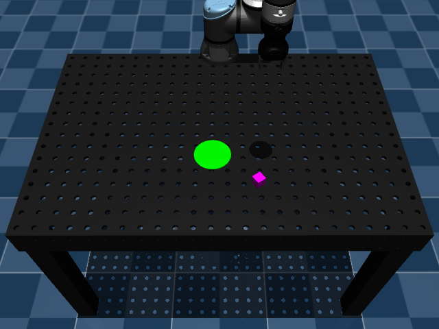
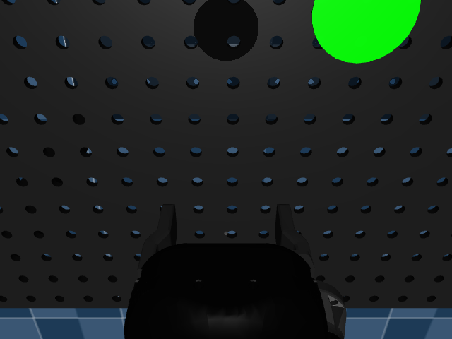

# Diffusion Policy pick-and-place on a simulated UR5e

A **Diffusion Policy** that picks up a cube and places it on a target, trained from camera images
on a simulated **UR5e arm with a Robotiq Hand-E gripper** in **MuJoCo**. A scripted
motion-planning expert produces the demonstrations. [LeRobot](https://github.com/huggingface/lerobot)
handles the dataset format, training and inference, and the
[Hugging Face Hub](https://huggingface.co/) stores the dataset and the trained policy.

| Exterior camera | Wrist camera |
|---|---|
|  |  |

```
scripted expert (IK + RRT*)  ──►  LeRobot dataset  ──►  HF Hub  ──►  lerobot-train (diffusion)  ──►  HF Hub  ──►  eval_policy.py
 scripts/box_movement_example.py   pick_place_lerobot/record.py         NVIDIA B200                                closed loop in MuJoCo
```

- Dataset: [MattoTT/ur5e_pick_place_v3](https://huggingface.co/datasets/MattoTT/ur5e_pick_place_v3)
- Trained policy: [MattoTT/diffusion_ur5e_pick_place_v3](https://huggingface.co/MattoTT/diffusion_ur5e_pick_place_v3)

**Result:** the final policy places the cube on the target in **19 of 20** seeded evaluation episodes
(35 of 40 over two runs), with a median placement error of 2 mm. See [Results](#results).

---

## The task

| | |
|---|---|
| Robot | UR5e + Robotiq Hand-E parallel gripper (`assets/scenes/scene.xml`) |
| Physics | MuJoCo, timestep 0.002 s (500 Hz) |
| Object | 3 cm cube at a random position (x ∈ [0.42, 0.68] m, y ∈ [−0.35, 0.35] m) and random yaw |
| Goal | Green disc, radius 6 cm, at a random position at least 15 cm from the cube |
| Task | Pick up the cube, put it down inside the green disc and release it |
| Observations | Two RGB cameras at 320×240: a fixed exterior camera framing the table and a wrist camera on the gripper. A 7-D state: 6 measured joint angles (rad) and the measured finger opening (0 = open … 255 = closed) |
| Action | 7-D: absolute joint targets for the 6 joints + gripper command (0 / 255) |
| Control rate | 25 Hz (one action per 20 physics steps) |

## Setup

Requires Python ≥ 3.12 and [uv](https://docs.astral.sh/uv/).

```bash
uv sync
```

On macOS the MuJoCo viewer needs `mjpython` (`uv run mjpython ...`). Headless commands work with
plain `uv run python ...` on any platform.

## 1. Data generation: the scripted expert

The expert (`scripts/box_movement_example.py::program`) returns one joint command per physics step
for a full episode:

1. **Reset.** Home pose, gripper open, cube at a random position and yaw.
2. **Grasp pose.** A top-down grasp centred on the cube. A cube looks the same every 90°, so the
   expert picks whichever of the four equivalent grasp yaws is closest to the current tool yaw. The
   target then depends only on what the cameras can see, and the wrist turns as little as possible.
3. **Approach pose.** The grasp pose raised 10 cm.
4. **Inverse kinematics.** `ik_LM` is retried from perturbed seeds, because the UR5e has up to 8 IK
   configurations. The expert keeps only solutions that are collision-free and inside joint limits. It
   also checks that the straight descent from the solution stays in the same IK branch.
5. **Motion planning.** OMPL **RRT\*** in joint space with MuJoCo collision checking
   (`src/rrt_planning.py`). Only exact solutions are accepted. The path is re-timed with a quintic
   profile, so the arm starts and stops smoothly and a held cube does not slip.
6. **Off-centre hover and correction** (see [§2](#2-making-the-policy-robust)).
7. **Pick.** Descend straight down (2 s), close the gripper (1 s), lift (2 s).
8. **Place.** Plan to the drop target the same way, descend, open the gripper, lift.

An episode is dropped if planning fails at any stage.

**Recording** (`pick_place_lerobot/record.py`, `expert_episode.py`):
- Physics runs at 500 Hz and a frame is saved every 20 steps (25 Hz).
- Each frame stores the observation *before* acting. The action stored with it is the target the expert
  reaches by the end of the next 20-step window. At deployment the policy does the same: observe, act,
  then follow that action for one frame.
- Episodes are generated in parallel worker processes, each with its own MuJoCo model and renderer.
  The number of finished episodes waiting to be written is capped to bound memory.
- The final dataset has **300 episodes, 147,290 frames** (about 20 s per episode), stored in LeRobot
  dataset format v3.0.

```bash
# Record 300 expert episodes
uv run python pick_place_lerobot/record.py --repo-id local/ur5e_pick_place_v3 --num-episodes 300

# Replay one
uv run lerobot-dataset-viz --repo-id local/ur5e_pick_place_v3 --episode-index 0

# Push to the Hugging Face Hub
uv run python pick_place_lerobot/export_data.py \
  --local-repo-id local/ur5e_pick_place_v3 --hub-repo-id <your-hf-user>/ur5e_pick_place_v3
```

To watch a single expert episode in the viewer: `uv run mjpython main.py`.

## 2. Making the policy robust

The dataset went through three versions. Each one fixed a problem found with the previous one.

| Version | Change | Why |
|---|---|---|
| **v1** | 640×480 frames, 4 cm cube | First baseline. Decoding the large PNGs slowed training, so `scripts/downscale_dataset.py` shrinks a copy of the dataset |
| **v2** | Render natively at **320×240** for both recording and evaluation | Training and evaluation see identical images, with no resize step |
| | Cube shrunk from **4 cm to 3 cm** | Its 42 mm diagonal fits inside the Hand-E's 50 mm opening at any yaw |
| | **Symmetric grasp yaw** (closest of the 4 equivalent yaws) | Without it, the wrist angle depended on a cube rotation the cameras cannot tell apart |
| **v3** | **Off-centre hover with correction**, at both pick and drop | See below |

**The v3 hover offset.** Before v3, the expert planned straight to the hover pose above the cube, so it
arrived exactly centred in every demonstration. The data never showed what to do when slightly off. A
policy that arrived 1–2 cm to one side had never seen a descent from there, and it stalled above the cube.

The expert now:
1. plans to a **randomly perturbed hover pose**: an xy offset drawn uniformly from a disc of radius
   **2.5 cm** plus a yaw offset of up to **±5°** (`HOVER_OFFSET_MAX`, `HOVER_YAW_OFFSET_MAX`);
2. makes a short straight correction to the true hover pose (up to about 1 s);
3. then descends as before.

This happens over the cube and over the drop target, so every demonstration includes a recovery from a
small positioning error. The hover height stays fixed at 10 cm; the offset is horizontal plus yaw.

## 3. Training

The policy is LeRobot's Diffusion Policy, trained on a single **NVIDIA B200 GPU**:

```bash
lerobot-train --dataset.repo_id=<your-hf-user>/ur5e_pick_place_v3 --policy.type=diffusion \
  --output_dir=outputs/train/diffusion_ur5e_v3 \
  --batch_size=128 --steps=100000 --num_workers=40 \
  --policy.horizon=64 --policy.n_action_steps=32 \
  --policy.crop_shape="[216, 288]" \
  --save_checkpoint=true --save_freq=20000 \
  --policy.push_to_hub=true --policy.repo_id=<your-hf-user>/diffusion_ur5e_pick_place_v3 \
  --accelerator.mixed_precision=bf16
```

The values below are from the trained model's `config.json` and `train_config.json`:

| | Setting | Value |
|---|---|---|
| **Observations** | `n_obs_steps` | 2 (the current frame and the previous one) |
| | Vision backbone | ResNet-18, ImageNet-pretrained, a separate encoder per camera, spatial softmax (32 keypoints) |
| | Image crop | 216×288 crop of the 240×320 frames, random in training (augmentation), centred at inference |
| | Normalisation | Images: mean/std. State and actions: min/max to [−1, 1] |
| **Actions** | `horizon` | 64 actions predicted (2.56 s at 25 Hz) |
| | `n_action_steps` | 32 executed (1.28 s) before predicting again |
| **Denoiser** | Network | 1-D conditional U-Net, channels 512 / 1024 / 2048, FiLM conditioning (~278 M parameters) |
| | Noise scheduler | DDPM, 100 timesteps, squared-cosine β schedule, ε-prediction |
| **Optimisation** | Optimiser | Adam, lr 1e-4, β = (0.95, 0.999), weight decay 1e-6, grad-norm clip 10 |
| | LR schedule | Cosine with 500 warm-up steps |
| | Batch size / steps | 128 / 100,000 (≈ 87 passes over the 147k frames) |
| | Precision | bf16 mixed precision |
| | Seed | 1000 |

On a 12 GB GPU, use `--batch_size=64`. If it still runs out of memory, add
`--policy.gradient_checkpointing=true`.

## 4. Evaluation

`pick_place_lerobot/eval_policy.py` runs the trained policy closed-loop in the same scene:

- **Reset.** The same randomisation as the expert: home pose, random cube, random drop target. Episode
  *i* uses seed `1000 + i`, so runs are reproducible and comparable across checkpoints.
- **Control loop.** At 25 Hz: render both cameras, read the state, call `policy.select_action`. Each
  action is ramped linearly from the previous target over the frame's 20 physics steps, the same way
  the expert sends per-step commands. Holding the target constant instead made the position servo jump
  every 40 ms, and that shaking slid the cube out of the gripper. An episode is capped at 700 steps (28 s).
- **Success.** All of the following hold for 12 consecutive frames (0.5 s):
  - the cube's centre is inside the green disc (within 6 cm of its centre);
  - the cube rests on the table;
  - the gripper is open.

By default the script downloads the trained policy from the Hub.

```bash
uv run python pick_place_lerobot/eval_policy.py --num-episodes 20 --headless
uv run mjpython pick_place_lerobot/eval_policy.py --num-episodes 5               # with the viewer
uv run python pick_place_lerobot/eval_policy.py --pretrained-path outputs/train/diffusion_ur5e_v3/checkpoints/last/pretrained_model
```

### Results

Policy v3 (`diffusion_ur5e_pick_place_v3`, 100k steps), 20 episodes (seeds 1000–1019), headless on an
Apple-silicon Mac (MPS), about 18 s per episode:

| Run | Success | Steps to success (25 Hz) | Placement error (successes) |
|---|---|---|---|
| Seeded (`torch` seeded per episode, reproducible) | **19 / 20 (95 %)** | mean 464 (18.5 s), range 364–642 | median 0.2 cm, max 1.1 cm |
| Earlier run, diffusion noise not seeded | 16 / 20 (80 %) | mean 463 (18.5 s), range 401–539 | median 0.1 cm, max 0.7 cm |

The expert takes about 490 steps per episode, so the policy finishes in a similar time.

Diffusion sampling is stochastic, so the same scene can succeed or fail depending on the noise. Over the
two runs the policy succeeded in **35 of 40** episodes (88 %). The failures were of two kinds:
- **Slow grasp** (seed 1008, failed in both runs): the cube is lifted late, around frame 600. It reaches
  the target, but the episode hits the 700-step limit before the cube is set down and released.
- **Stall above the cube** (seed 1012, unseeded runs): the gripper hovers about 10 cm above the cube and never
  descends. The v3 hover offset targets this failure; it still happens occasionally.

## Repository layout

```
main.py                            Watch one expert episode in the MuJoCo viewer
assets/scenes/scene.xml            Scene: UR5e + Hand-E + wrist camera, table, cube, drop disc, exterior camera
assets/UR5eGripper/                Robot model (see its README for sources and licence)
scripts/box_movement_example.py    Scripted expert: grasp pose, IK, RRT*, hover offset, pick and place
scripts/view_scene.py              Open the scene in the viewer
scripts/downscale_dataset.py       Shrink a 640×480 image dataset to 320×240 JPEG (v1 only)
src/rrt_planning.py                OMPL RRT* joint-space planner with MuJoCo collision checks
src/robot.py                       UR5e kinematics, IK moves, MuJoCo control and collision helpers
src/cam.py                         Camera rendering
pick_place_lerobot/
  lerobot_dataset.py               Dataset schema (features, 25 Hz, 320×240)
  expert_episode.py                Run one expert episode headless and record frames + actions
  record.py                        Parallel recording into a LeRobot dataset
  export_data.py                   Push a local dataset to the Hugging Face Hub
  eval_policy.py                   Closed-loop evaluation of a trained policy
```

## Licence

The code is MIT-licensed (see [LICENSE](LICENSE)). The robot model has its own licence and sources; see
[`assets/UR5eGripper/README.md`](assets/UR5eGripper/README.md).
