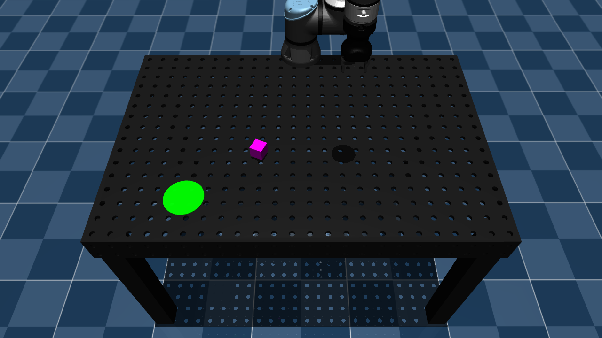
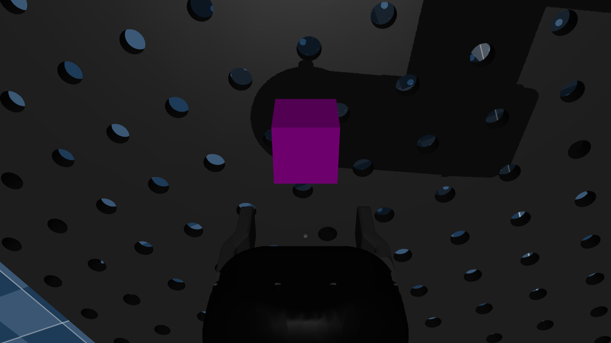

# Diffusion Policy pick-and-place on a simulated UR5e

This project trains a **Diffusion Policy** to pick up a cube and place it on a target with a
simulated **UR5e arm and Robotiq Hand-E gripper** in **MuJoCo**. A scripted motion-planning
expert produces the demonstrations. **LeRobot** handles the dataset format, training and
policy inference. The **Hugging Face Hub** stores the datasets, trained policies and training logs.

```
scripted expert (IK + RRT*)  ──►  LeRobot dataset  ──►  HF Hub  ──►  lerobot-train (diffusion)  ──►  HF Hub  ──►  eval_policy.py
 box_movement_example.py          record.py                         NVIDIA B200 / Colab A100 /                  closed loop in MuJoCo
 expert_episode.py                lerobot_dataset.py                local RTX 4070 Ti
```

---

## 1. The task

| Exterior camera | Wrist camera |
|---|---|
|  |  |

| | |
|---|---|
| Robot | UR5e + Robotiq Hand-E parallel gripper (`assets/scenes/scene.xml`) |
| Physics | MuJoCo, timestep 0.002 s (500 Hz), implicit-fast integrator |
| Object | 3 cm magenta cube, random position x ∈ [0.42, 0.68] m, y ∈ [−0.35, 0.35] m, random yaw ±180° |
| Goal | Green disc, radius 6 cm, random position at least 15 cm from the box |
| Task | Pick up the cube, put it down inside the green disc, release it |
| Observations | Two RGB cameras at 320×240: a fixed exterior camera that frames the table and a wrist camera on the gripper (both modelled on a RealSense D415, 43° FOV), plus a 7-D state: 6 measured joint angles (rad) and the measured finger opening (0 = open … 255 = closed) |
| Action | 7-D: absolute joint targets for the 6 joints + gripper command (0 / 255) |
| Control rate | 25 Hz (one action per 20 physics steps) |

## Setup

Requires Python ≥ 3.12 and [uv](https://docs.astral.sh/uv/).

```bash
uv sync
```

## 2. Hugging Face and LeRobot

- **LeRobot (≥ 0.7)**
  - `LeRobotDataset.create(...)` defines the dataset schema. Recording uses `add_frame` / `save_episode` / `finalize` (dataset format v3.0).
  - `lerobot-dataset-viz` replays recorded episodes.
  - `lerobot-train --policy.type=diffusion` does the training.
  - `DiffusionPolicy.from_pretrained` + `make_pre_post_processors` handle inference. The processors apply the training normalisation statistics.
- **Hugging Face Hub** carries data between machines. Everything is private:
  - Datasets: `MattoTT/ur5e_pick_place` (v1), `MattoTT/ur5e_pick_place_v2`, `MattoTT/ur5e_pick_place_v3`
  - Policies: `MattoTT/diffusion_ur5e_pick_place`, `…_v2`, `…_v3`
  - Training curves: Trackio space `MattoTT/ur5e-tracker`
- Workflow: record on a local machine → `export_data.py` pushes the dataset to the Hub → train on a GPU server and push the policy to the Hub → evaluate on the Mac by loading the policy from the Hub.

## 3. Data generation: the scripted expert

The expert is `scripts/box_movement_example.py::program`. It returns a queue of per-physics-step joint
commands for one episode:

1. **Reset.** Home pose, gripper open, cube at a random position and yaw.
2. **Grasp pose.** A top-down grasp centred on the cube. A cube looks the same every 90°, so the
   expert picks whichever of the four equivalent grasp yaws is closest to the current tool yaw. The
   target then depends only on what the cameras can see, and the wrist turns as little as possible.
3. **Approach pose.** The grasp pose raised 10 cm.
4. **Inverse kinematics.** `ik_LM` is retried from perturbed seeds, because the UR5e has up to 8 IK
   configurations. The expert keeps only solutions that are collision-free and inside joint limits. It
   also checks that the straight descent from the solution stays in the same IK branch.
5. **Motion planning.** OMPL **RRT\*** in joint space with a 20 s budget and MuJoCo collision checking
   (`src/rrt_planning.py`). Only exact solutions are accepted. The path is re-timed with a quintic
   profile (`smooth_timing`), so the arm starts and stops smoothly and a held box does not slide.
6. **Off-centre hover and correction** (see §4).
7. **Pick.** Descend straight down for 2 s, close the gripper over 1 s, lift for 2 s.
8. **Place.** Sample the drop target, plan to it the same way, descend, open the gripper, lift.

An episode is dropped if planning fails at any stage.

**Recording** (`pick_place_lerobot/record.py`, `expert_episode.py`):
- Physics runs at 500 Hz and a frame is saved every 20 steps (25 Hz).
- Each frame stores the observation *before* acting. The action stored with it is the target the expert
  reaches by the end of the next 20-step window (`frame_targets`). At deployment the policy does the same:
  observe, then act, then hold that action for one frame.
- Episodes are generated in parallel, one process per worker (CPU count − 2), each with its own MuJoCo
  model and renderer. A finished episode holds about 200 MB of raw frames. The number of episodes in flight
  is capped so that results waiting to be written do not exhaust RAM. `dataset.finalize()` runs in a
  `finally` block, so the dataset stays readable after Ctrl-C or a crash.
- An expert episode is about 450–500 frames (18–20 s). The README command records 300 episodes.

```bash
uv run python pick_place_lerobot/record.py --repo-id local/ur5e_pick_place_v3 --num-episodes 300
uv run python pick_place_lerobot/export_data.py --local-repo-id local/ur5e_pick_place_v3 --hub-repo-id MattoTT/ur5e_pick_place_v3
```

## 4. Making the policy more robust (dataset versions)

| Version | Change | Why |
|---|---|---|
| **v1** | 640×480 frames, 4 cm cube. Trained with `resize_shape=[240,320]`, `crop_ratio=0.9`, 30k steps | First baseline. Decoding PNGs was the training bottleneck, so `scripts/downscale_dataset.py` was written to shrink a copy of the dataset |
| **v2** | Render natively at **320×240** for both recording and evaluation | Training and evaluation see identical images, with no resize step |
| | Cube shrunk from **4 cm to 3 cm** | Its 42 mm diagonal fits inside the Hand-E's 50 mm opening at any yaw |
| | **Symmetric grasp yaw** (closest of the 4 equivalent yaws) | Without it, the wrist angle depended on a cube rotation the cameras cannot tell apart |
| **v3** | **Off-centre hover with correction**, at both pick and drop | See below |

**The v3 hover offset.** Before v3, the expert planned straight to the hover pose above the box, so it
arrived exactly centred in every demonstration. The data never showed what to do when slightly off. A
trained policy that arrived 1–2 cm off to one side had never seen a descent from there, and it stalled
above the box.

The expert now:
1. plans to a **randomly perturbed hover pose**: an xy offset drawn uniformly from a disc of radius
   **2.5 cm** (`HOVER_OFFSET_MAX`) plus a yaw offset of up to **±5°** (`HOVER_YAW_OFFSET_MAX`);
2. makes a short straight correction (`move_l`) to the true hover pose. It takes 0.4 s + 24 s/m × offset,
   so about 1 s for the largest offset;
3. then descends as before.

This happens over the box and over the drop target, so every demonstration includes a recovery from a
small positioning error.

> The offset is **horizontal (xy) plus yaw**. The hover height stays fixed at 10 cm above the
> grasp/drop pose. The height above the box is not varied.

## 5. Training

Diffusion Policy is trained with `lerobot-train`. Parameters from `pick_place_lerobot/README.md`:

| Parameter | Value | Meaning |
|---|---|---|
| `--policy.type` | `diffusion` | Diffusion Policy (conditional U-Net denoiser over action sequences) |
| `--policy.horizon` | 16 | Predicts 16 future actions (0.64 s at 25 Hz) |
| `--policy.n_action_steps` | 8 | Executes 8 of them (0.32 s) before predicting again |
| `--policy.crop_shape` | [216, 288] | 90 % crop of the 240×320 images (random crop in training as augmentation) |
| `--batch_size` | 128 (B200) / 64 (local RTX 4070 Ti) | |
| `--steps` | 100 000 | (v1 used 30 000) |
| `--num_workers` | 40 (server) / `nproc − 2` (local) | Data-loading workers |
| `--accelerator.mixed_precision` | bf16 | |
| `--save_freq` | 20 000 (server) / 10 000 (local) | Checkpoint interval |
| `--policy.push_to_hub` | true | The finished policy goes to the Hub |
| `--trackio.enable` | true | Loss curves logged to the Trackio space on HF |

Settings not passed on the command line keep LeRobot's diffusion defaults.

**Compute.** v1 was trained on a Colab A100. Later runs used an NVIDIA B200 GPU
(outputs in `outputs/train/`). A local RTX 4070 Ti (12 GB) can train at batch size 64.

The README commands still name the v2 dataset. The v3 policy (`MattoTT/diffusion_ur5e_pick_place_v3`),
which `eval_policy.py` now loads by default, was presumably trained with the same parameters on
`MattoTT/ur5e_pick_place_v3`. The exact v3 command is not in the repo.

## 6. Evaluation

`pick_place_lerobot/eval_policy.py` runs the trained policy closed-loop in the same MuJoCo scene:

- **Loading.** `DiffusionPolicy.from_pretrained` reads either a Hub repo id or a local
  `pretrained_model` folder. The pre/post-processors normalise the observations and map the actions back
  to radians and the 0..255 gripper range. Runs on CUDA, MPS or CPU.
- **Reset.** Uses the same randomisation functions as the expert (home pose, random cube, random drop
  target). Episode *i* uses seed `1000 + i`, so evaluations can be reproduced and compared across
  checkpoints.
- **Control loop.** At 25 Hz: render both cameras, read the state, call `policy.select_action`, apply the
  action. An episode is capped at 700 steps (28 s), against 450–500 for the expert.
- **Action execution** (current uncommitted change). Each action is linearly ramped from the previous
  target over the frame's 20 physics steps, the same way the expert sends per-step commands. Holding each
  action constant made the position servo jump every 40 ms, and that shaking slid the box out of the
  gripper during the carry.
- **Success criterion.** All of the following hold for **12 consecutive frames (0.5 s)**:
  - the box centre is within **6 cm** of the disc centre (inside the green disc);
  - the box rests on the table (height < half-size + 5 mm);
  - the gripper is commanded open (< 128).
- **Output.** Per episode: success or fail, step count and final box-to-target distance. At the end: the
  overall success rate. The script can run headless or with the MuJoCo viewer (`mjpython` on macOS).

```bash
uv run python pick_place_lerobot/eval_policy.py --num-episodes 20 --headless
uv run mjpython pick_place_lerobot/eval_policy.py --num-episodes 5            # with viewer
uv run python pick_place_lerobot/eval_policy.py --pretrained-path <local checkpoint>/pretrained_model
```

**Results:** _not recorded in the repo yet. Add the success rates for v1/v2/v3 here._

## 7. Repo map

```
assets/scenes/scene.xml            MuJoCo scene: UR5e + Hand-E + wrist cam, table, cube, drop disc, exterior cam
scripts/box_movement_example.py    Scripted expert: grasp pose, IK, RRT*, hover offset, pick & place
src/rrt_planning.py                OMPL RRT* joint-space planner with MuJoCo collision checks
src/robot.py, src/cam.py           Robot control/IK helpers, camera rendering
pick_place_lerobot/
  lerobot_dataset.py               Dataset schema (features, 25 Hz, 320×240)
  expert_episode.py                Runs one expert episode headless and records frames + actions
  record.py                        Parallel recording into a LeRobot dataset
  export_data.py                   Push a local dataset to the HF Hub
  eval_policy.py                   Closed-loop evaluation of a trained policy
  README.md                        Record / replay / train commands
scripts/downscale_dataset.py       (v1 only) shrink a 640×480 dataset to 320×240 JPEG
```
